# My Projects

## Index

- [Customer Churn Predictor](#customer-churn-predictor)
- [EV Charging Station Usage Analysis](#ev-charging-station-usage-analysis)
- [InfoPal](#infopal)
- [UniOps](#uniops)
- [Emotion-Satisfaction Analysis](#emotion-satisfaction-analysis)
- [HealthyPaws](#healthypaws)
- [MerNote](#mernote)
- [BusyBus](#busybus)
- [CookBook](#cookbook)

### Customer Churn Predictor

#### Description

End-to-end ML system that predicts customer churn with 80% accuracy using Logistic Regression. Built sklearn pipeline with preprocessing, LLM integration via OpenRouter for AI-generated retention recommendations. Identified $1.3M+ at-risk revenue with risk scoring (HIGH/MEDIUM/LOW) and interactive Streamlit dashboard.

#### Technologies

- **ML & Processing:** Scikit-learn, Pandas, Python
- **Explainability & API:** FastAPI
- **Dashboard:** Streamlit, Plotly
- **LLM:** OpenRouter

   

---

### EV Charging Station Usage Analysis

#### Description

Performed end-to-end analysis on 200K+ EV charging records to identify usage patterns, energy trends, and station performance insights. Built ETL workflows and interactive dashboards for business intelligence reporting.

**Period:** 2026 Feb – Apr

#### Technologies

- **ETL & Data Warehousing:** SQL Server, SSIS for building ETL workflows and dimensional modeling.
- **Analytics & BI:** SSAS for OLAP cubes, Power BI for interactive dashboards and reporting.
- **Data Processing:** Python for additional data preprocessing and analysis tasks.

    

#### Screenshots

| 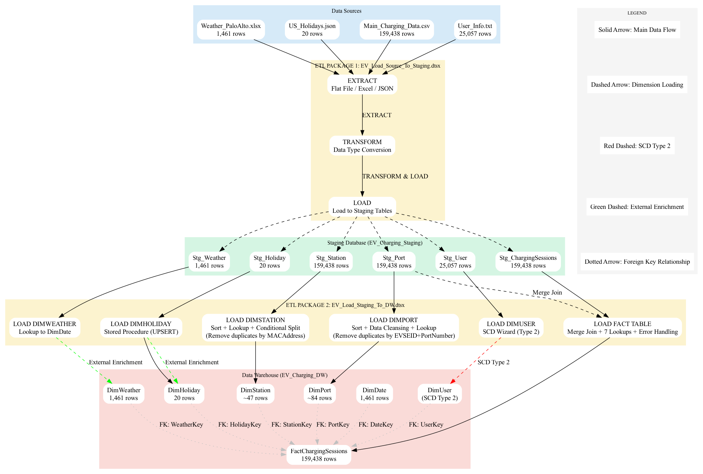 |
| :-------------------------------------------------: |

---

### InfoPal

#### Description

Built a prototype Retrieval-Augmented Generation (RAG) pipeline for document-based question answering using a local LLM setup. Implemented document ingestion, semantic search using FAISS, and context-aware response generation using Mistral-7B.

**Period:** 2026 Jan

#### Key Features

- **Document Ingestion:** Process and chunk documents for efficient retrieval.
- **Semantic Search:** FAISS-based vector search for relevant document retrieval.
- **Context-Aware Generation:** Mistral-7B LLM for generating accurate responses based on retrieved context.
- **Interactive UI:** Streamlit-based interface for easy document upload and querying.

#### Technologies

- **RAG Pipeline:** Python for core RAG implementation and orchestration.
- **Vector Search:** FAISS for efficient similarity search on document embeddings.
- **Embeddings:** Sentence Transformers for generating semantic document representations.
- **LLM:** Mistral-7B for context-aware response generation.
- **Frontend:** Streamlit for rapid prototyping and interactive user interface.

   

#### Screenshots

| 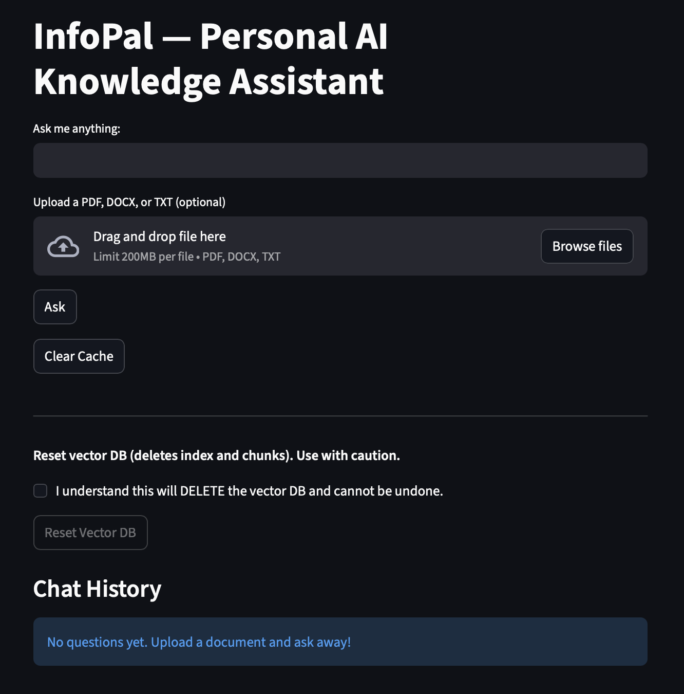 | 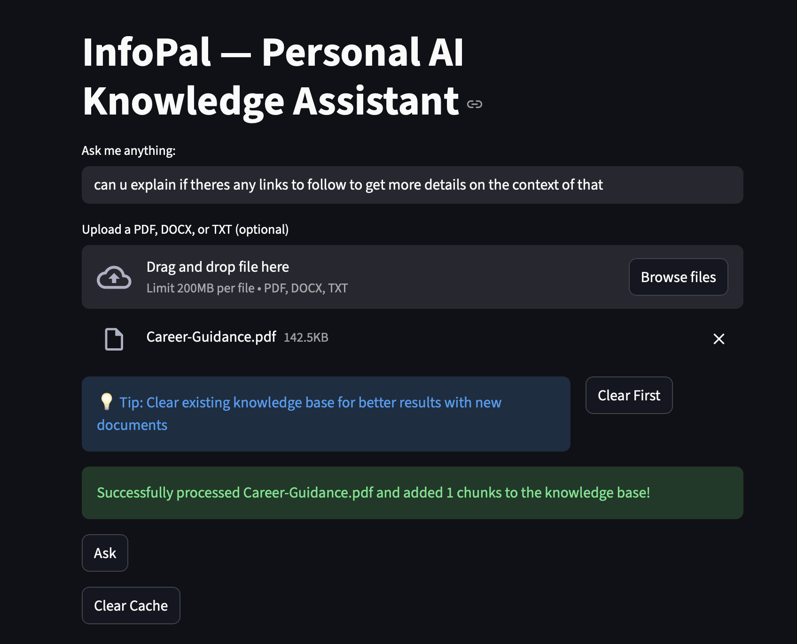 | 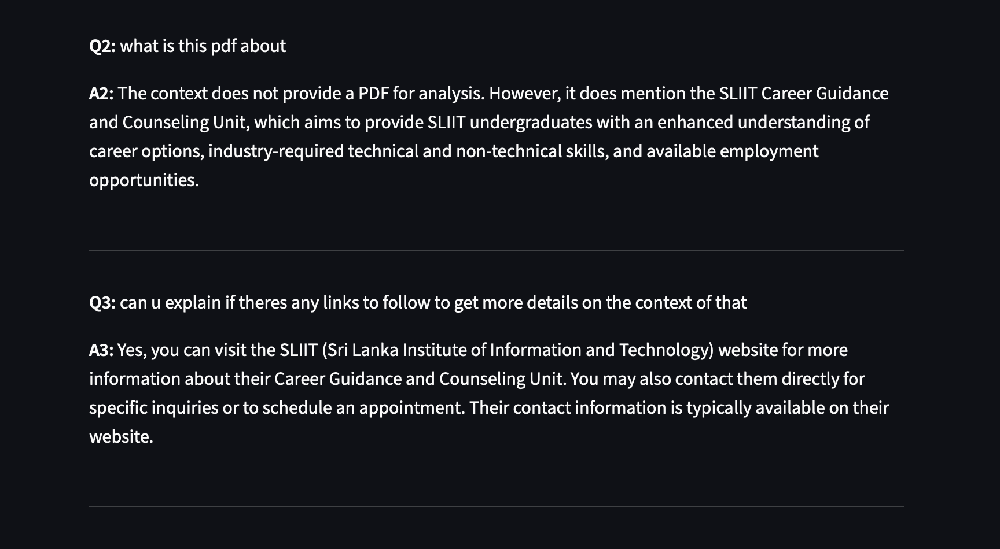 |
| :----------------------------------: | :----------------------------------: | :----------------------------------: |

---

### UniOps

#### Description

University facility management system with resource booking, incident ticketing, and real-time notifications. My contribution: Module A (Facilities & Assets Catalogue) – full stack development including 13 RESTful API endpoints with Spring Boot, role-based access control, and React admin dashboard with advanced filtering, real-time analytics, and PDF export. Optimized performance with debounced search and MongoDB indexing.

**Period:** 2026 Feb – Apr

#### Technologies

- **Backend:** Spring Boot 3.x, MongoDB Atlas, Maven
- **Frontend:** React 18, DaisyUI, Tailwind CSS
- **Authentication:** OAuth 2.0
- **API:** REST

   

---

### Emotion-Satisfaction Analysis

#### Description

Multi-activity comparative study validating whether emotional connection predicts satisfaction across entertainment domains (movies, social media, music). Implemented descriptive, inferential, predictive, and meta-analysis using R. My contribution: music dataset analysis with strong evidence (r=0.215, p<0.001, OR=1.731) supporting the hypothesis.

**Period:** 2026 Feb – Mar

#### Key Findings

- **Correlation Analysis:** Demonstrated significant positive correlation (r=0.215) between emotional connection and satisfaction in music domain.
- **Statistical Significance:** Strong evidence with p-value < 0.001.
- **Odds Ratio:** Users with emotional connection were 1.731 times more likely to report satisfaction.
- **Meta-Analysis:** Combined effect sizes across all entertainment domains for comprehensive validation.

#### Technologies

- **Statistical Analysis:** R for comprehensive statistical computing.
- **Data Manipulation:** Tidyverse for data wrangling and transformation.
- **Meta-Analysis:** Meta package for combining effect sizes across studies.
- **Visualization:** ggplot2 for publication-quality statistical graphics.
- **Effect Sizes:** Effectsize package for standardized effect size calculation.
- **Predictive Modeling:** Caret with Logistic Regression for classification tasks.

  

#### Screenshots

| 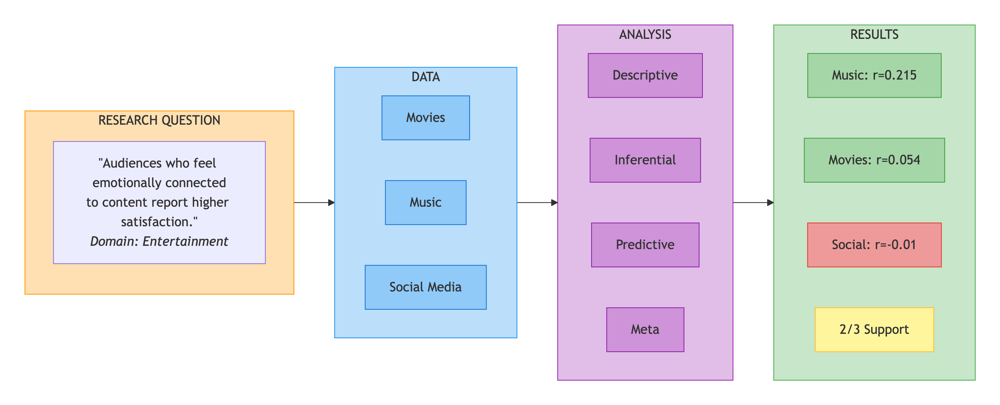 |
| :---------------------------------------------------------: |

---

### HealthyPaws

#### Description

Developed billing and finance module for a MERN-based veterinary system, focusing on secure and automated payment workflows. Implemented Stripe payments, invoicing, refunds, coupon system, and financial dashboards.

**Period:** 2025 Aug – Oct

#### Key Features

- **Payment Processing:** Stripe integration for secure online payments.
- **Invoicing System:** Automated invoice generation and management.
- **Refund Management:** Complete refund workflow with transaction tracking.
- **Coupon System:** Discount code management and validation.
- **Financial Dashboards:** Real-time financial analytics and reporting for finance managers.
- **Offline Payments:** Support for cash and check payment recording.

#### Technologies

- **Frontend:** React.js with TailwindCSS for responsive and modern UI.
- **Backend:** Node.js and Express.js for RESTful API development.
- **Database:** MongoDB for flexible data storage.
- **Authentication:** JWT for secure role-based access control.
- **Payments:** Stripe API for payment processing and webhooks.
- **Document Generation:** PDFKit for invoice and report PDF generation.

       

#### Screenshots

| 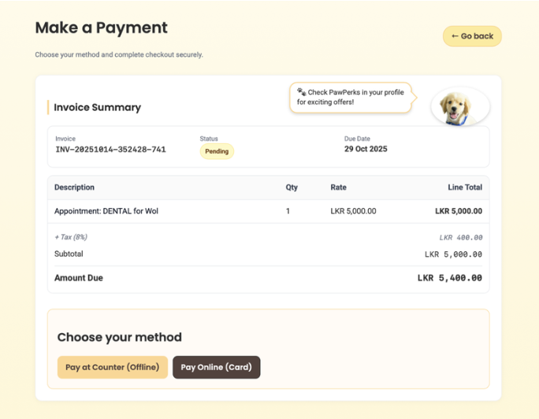 | 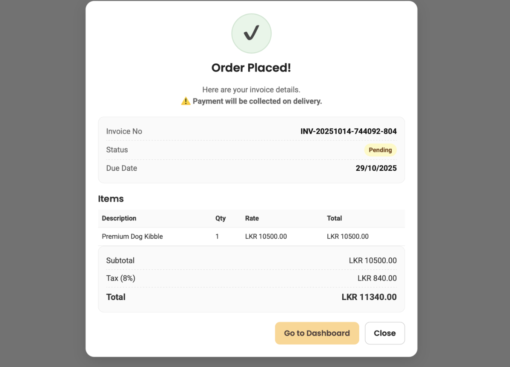 | 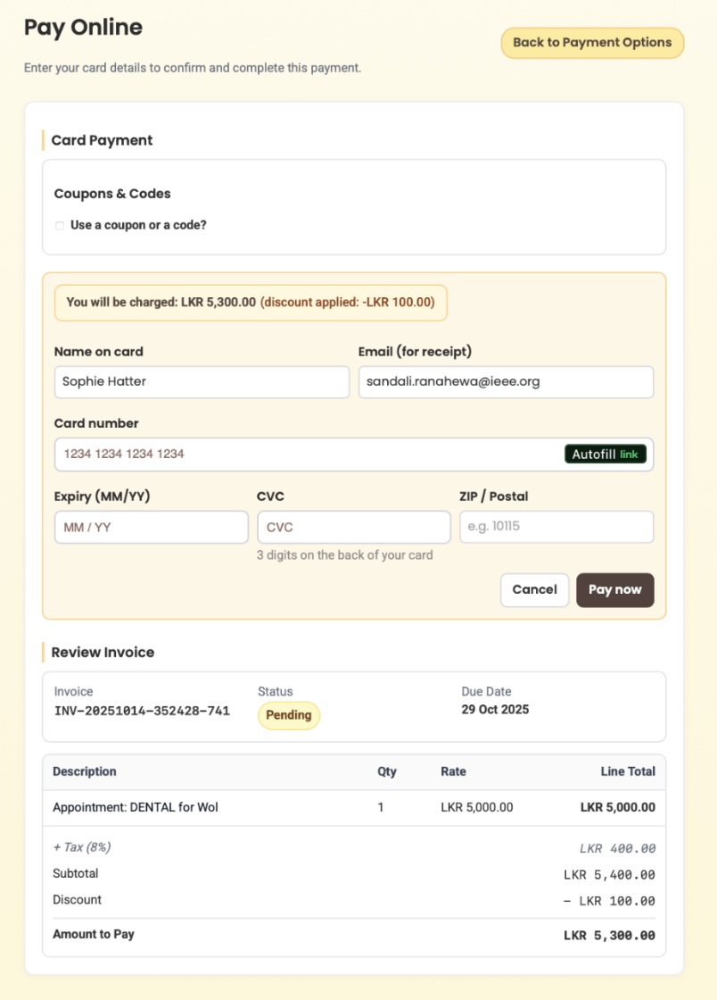 |
| :------------------------------------------------------------: | :----------------------------------------------------: | :------------------------------------: |
| 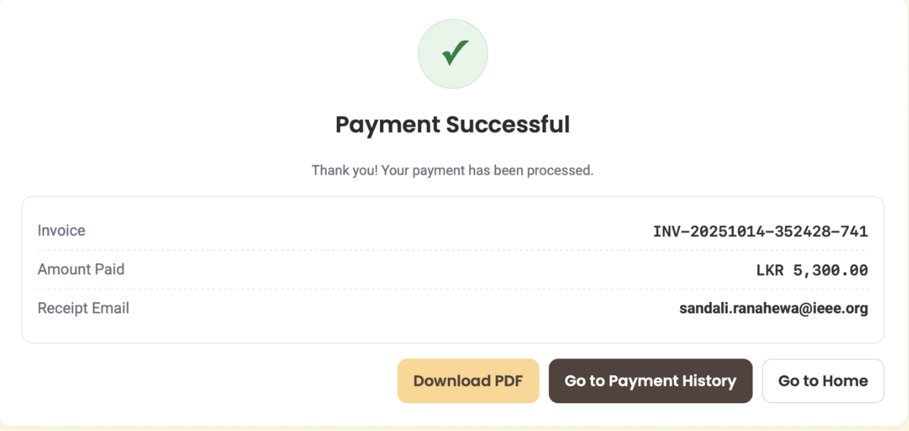 | 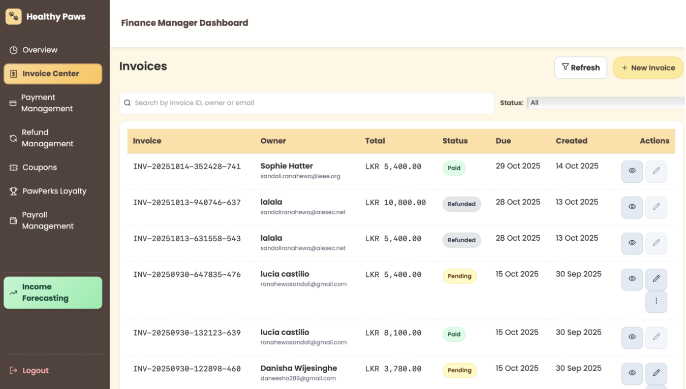 | |

---

### MerNote

 

#### Description

Personal notes app with full CRUD, JWT authentication, and bcrypt password hashing. Features dark/light theme toggle, note color themes, debounced search, and a token-based password reset flow via Resend email API. Rate-limited with Upstash Redis (sliding window). Containerized with Docker multi-stage build, reverse-proxied through Nginx with SSL, and self-hosted on a DigitalOcean droplet.

**Period:** 2025 Jun

#### Key Features

- **CRUD Operations:** Complete create, read, update, delete functionality for notes.
- **User Authentication:** Secure login, registration, and password reset.
- **Caching & Rate Limiting:** Redis (Upstash) for performance and sliding window rate limiting.
- **Containerization & Deployment:** Docker, Nginx, SSL, DigitalOcean.

#### Technologies

- **Frontend:** React 19, Tailwind CSS, DaisyUI
- **Backend:** Node.js, Express.js
- **Database:** MongoDB Atlas
- **Authentication:** JWT, bcrypt
- **Caching & Rate Limiting:** Upstash Redis
- **Email:** Resend API
- **Deployment:** Docker, Nginx, DigitalOcean

        

#### Screenshots

| 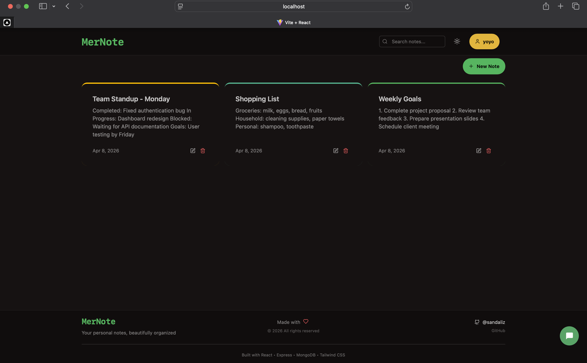 | 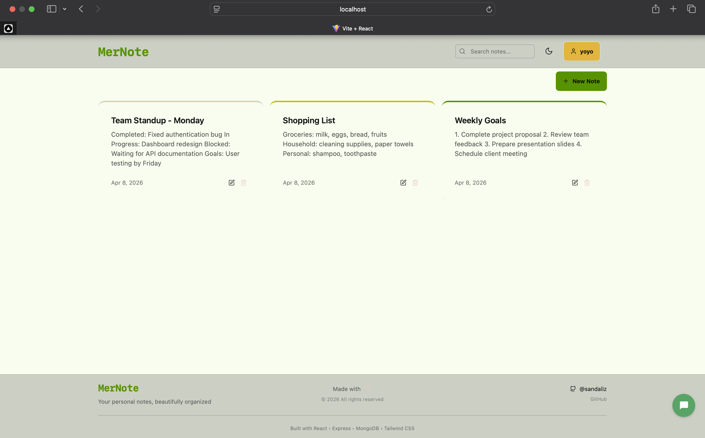 |
| :----------------------------------: | :----------------------------------: |

---

### BusyBus

#### Description

Contributed to BusOperator use case implementation of an MVC-based bus reservation system with thread-safe backend design using Singleton database architecture. Implemented full CRUD functionality with responsive frontend and database-driven booking system.

**Period:** 2025 Apr – May

#### Key Features

- **Bus Operator Dashboard:** Complete bus and schedule management interface.
- **CRUD Operations:** Create, read, update, delete for bus routes and schedules.
- **Singleton Database:** Thread-safe database connection management.
- **MVC Architecture:** Clean separation of concerns for maintainable code.
- **Responsive Design:** Mobile-friendly frontend for on-the-go management.

#### Technologies

- **Backend:** Java with MVC architecture pattern.
- **Frontend:** JSP for dynamic content rendering with HTML, CSS, JavaScript.
- **Database:** MySQL for relational data storage.
- **Design Pattern:** Singleton for database connection management.

     

#### Screenshots

| 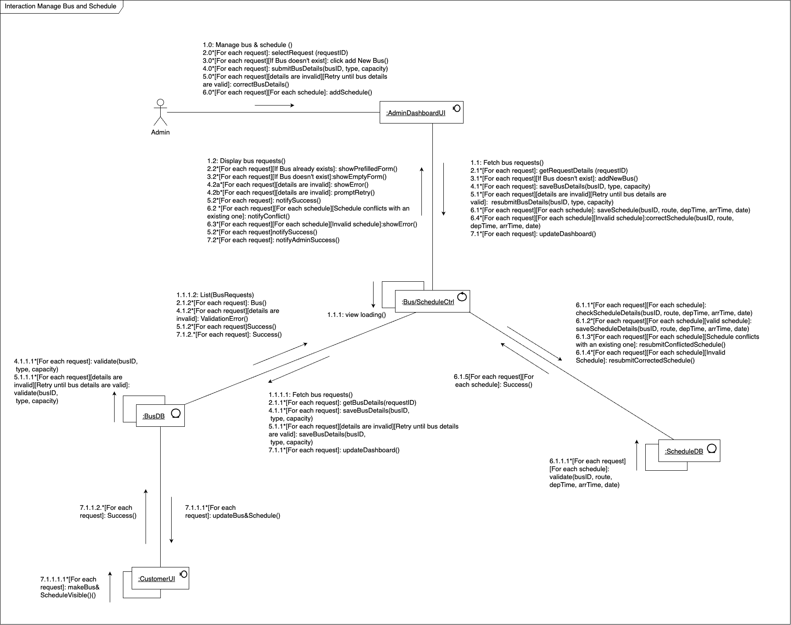 |
| :--------------------------------: |

---

### CookBook

#### Description

Designed a mobile application prototype for busy individuals to manage recipes, get personalized suggestions, and access AI-powered cooking assistance. Features include smart recipe discovery, personalized meal planning, step-by-step cooking instructions with timers, and real-time AI chef assistance for cooking queries. Created as an ideathon project focusing on UI/UX design and feature demonstration.

**Period:** 2025 Sep

#### Key Features

- **Smart Recipe Discovery:** Intelligent recipe recommendations based on preferences and available ingredients.
- **Personalized Meal Planning:** Custom meal plans tailored to dietary restrictions and goals.
- **Step-by-Step Cooking:** Detailed instructions with integrated timers for each step.
- **AI Chef Assistant:** Real-time AI-powered cooking assistance for queries and substitutions.
- **Recipe Management:** Save, organize, and share favorite recipes.

#### Technologies

- **Development:** Android Studio for mobile app development.
- **Language:** Kotlin for modern Android development.
- **Design:** UI/UX prototyping and design implementation.

 

#### Screenshots

| 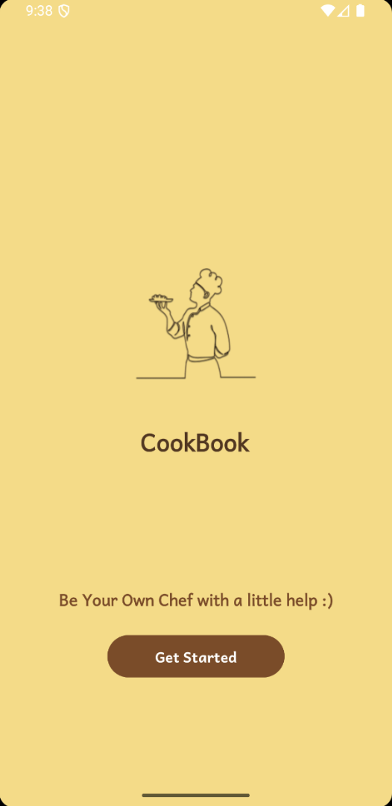 | 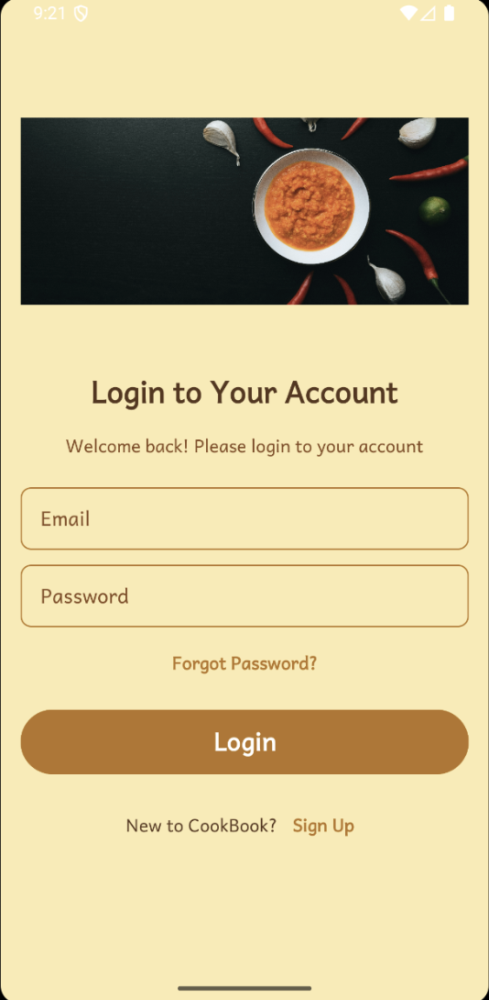 | 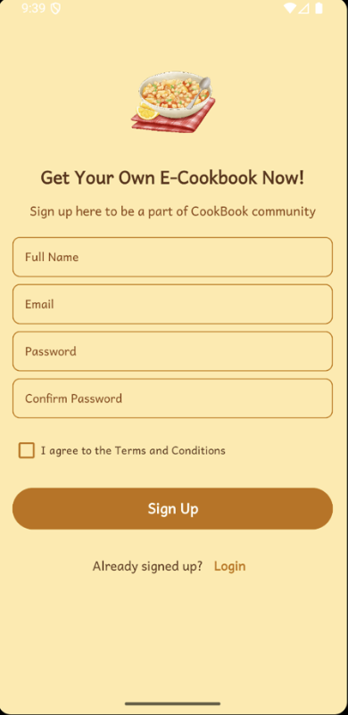 |
| :------------------------------------: | :------------------------------------: | :------------------------------------: |
| 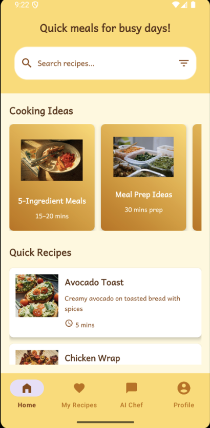 | 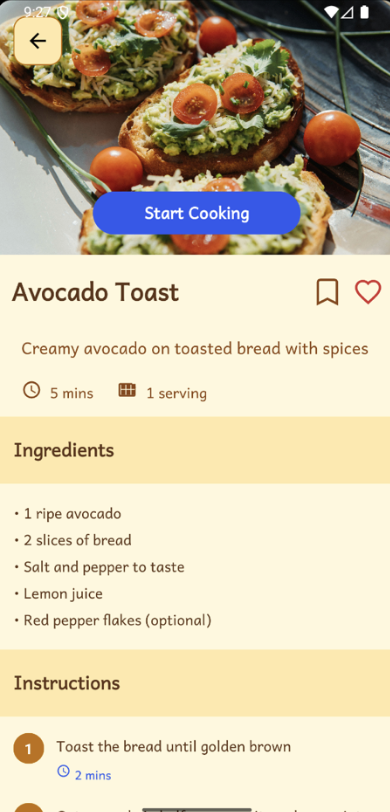 | 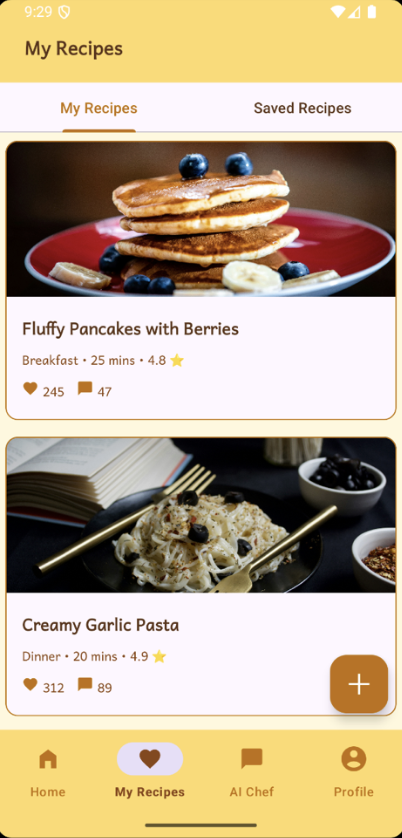 |
| 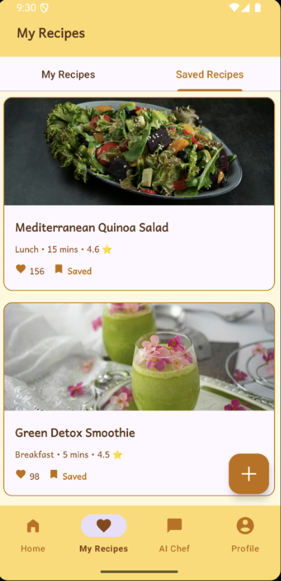 | 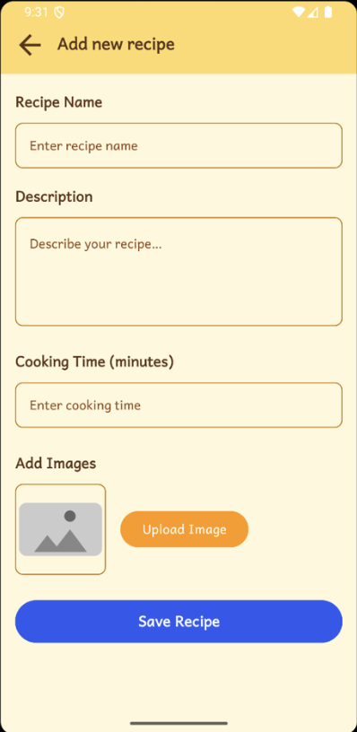 | 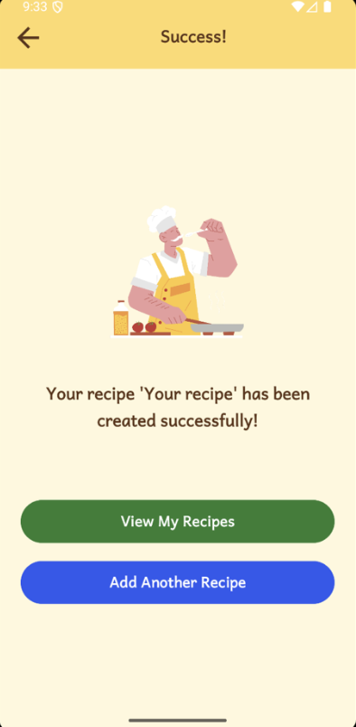 |
|  | 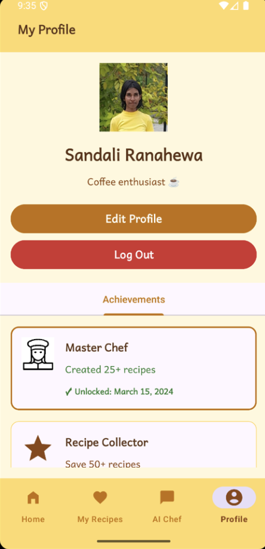 | |

---

© 2026 Sandali Ranahewa
